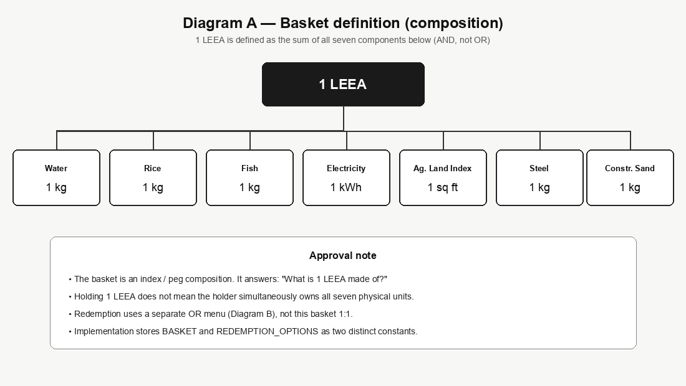
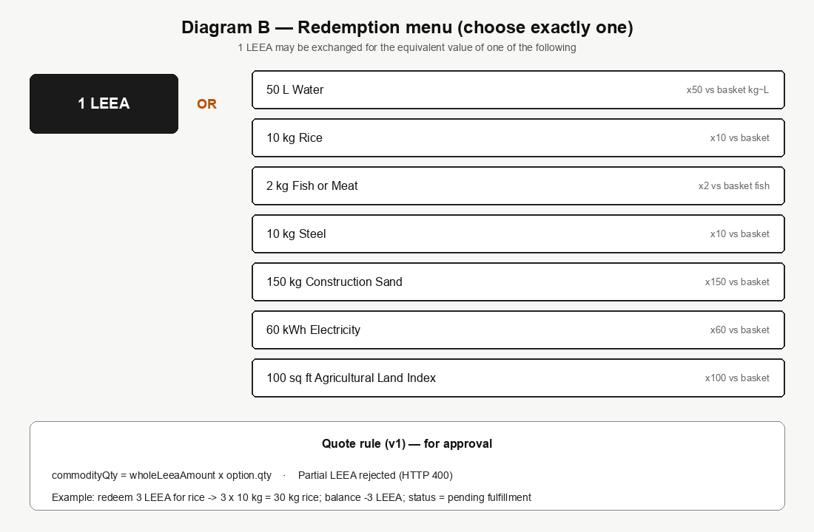
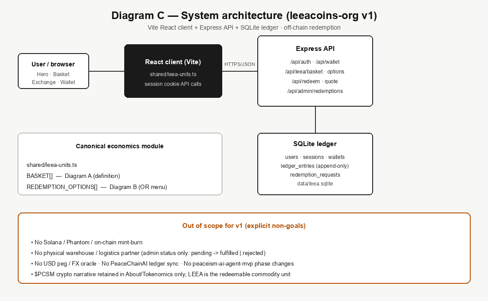
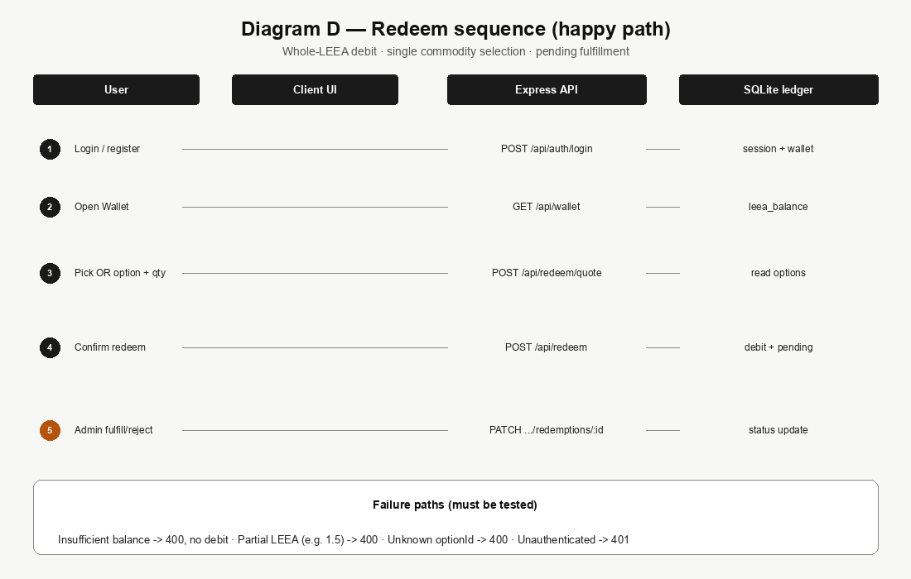

# LEEA Commodity Product — Approval Brief

**Date:** August 10, 2026  
**Status:** Pending approval — do not implement until signed off  
**Home:** `leeacoins-org/` (rebuild from static Netlify dump into product)  
**Scope:** Full product slice — basket definition UI, OR redemption exchange, app wallet, Express + SQLite ledger  
**Source rules:** Commodity definition and exchange schedule as stated 2026-08-09 (WhatsApp)

## 1. Decision requested

Approve rebuilding [`leeacoins-org`](../) into a LEEA commodity product that:

1. Publishes the **basket definition** (what 1 LEEA is composed of).
2. Lets users **redeem whole LEEA** for exactly one commodity from the OR menu.
3. Tracks balances and redemption requests in a local SQLite ledger (off-chain v1).

Sign-off authorizes implementation only. Physical logistics, on-chain mint, and USD peg remain out of scope until a later brief.

## 2. Why two layers (critical)

The source messages define **two different economic roles**. Treating them as one formula would ship incorrect product behavior.

| Layer | Question it answers | Operator | Implementation constant |
|---|---|---|---|
| Basket definition | What is 1 LEEA *made of*? | AND (all seven components) | `BASKET` |
| Redemption menu | What can 1 LEEA be *exchanged for*? | OR (exactly one option) | `REDEMPTION_OPTIONS` |





## 3. Canonical schedules (lock these numbers)

### 3.1 Basket definition — 1 LEEA is defined as

| # | Commodity | Quantity | Unit |
|---|---|---:|---|
| 1 | Water | 1 | kg |
| 2 | Rice | 1 | kg |
| 3 | Fish | 1 | kg |
| 4 | Electricity | 1 | kWh |
| 5 | Agricultural Land Index | 1 | sq ft |
| 6 | Steel | 1 | kg |
| 7 | Construction Sand | 1 | kg |

### 3.2 Redemption menu — 1 LEEA may be exchanged for one of

| # | Commodity | Quantity | Unit | Implied multiplier vs basket component |
|---|---|---:|---|---:|
| 1 | Water | 50 | L | ~×50 (treating 1 L ≈ 1 kg water) |
| 2 | Rice | 10 | kg | ×10 |
| 3 | Fish or Meat | 2 | kg | ×2 |
| 4 | Steel | 10 | kg | ×10 |
| 5 | Construction Sand | 150 | kg | ×150 |
| 6 | Electricity | 60 | kWh | ×60 |
| 7 | Agricultural Land Index | 100 | sq ft | ×100 |

**Quote rule (v1):** `commodityQty = wholeLeeaAmount × option.qty`. Partial LEEA amounts are rejected.

**Example:** Redeem 3 LEEA for rice → debit 3 LEEA, credit a pending request for 30 kg rice.

## 4. Product home and brand

| Topic | Decision |
|---|---|
| Repository folder | `leeacoins-org/` |
| Current state | Offline SPA dump from `peaceism.netlify.app` (no `src/`, no API, branded LeeaCoins / $PCSM) |
| Rebuild | Archive dump to `legacy/`; new Vite + React + TypeScript client; Express API; SQLite |
| Primary brand | **LEEA** commodity unit |
| $PCSM | Related crypto narrative only (About / Tokenomics / whitepaper link); not the redeemable unit |
| Wallet v1 | App account (email/password session). No Phantom / Solana in v1 |

## 5. System architecture



### 5.1 Target layout

```
leeacoins-org/
├── legacy/                 # current dump
├── shared/leea-units.ts    # BASKET + REDEMPTION_OPTIONS
├── server/                 # Express + SQLite
├── client/                 # Vite React SPA
├── data/leea.sqlite
└── README.md
```

### 5.2 API surface (v1)

| Method | Path | Behavior |
|---|---|---|
| GET | `/api/leea/basket` | Return basket composition |
| GET | `/api/leea/redemption-options` | Return OR menu |
| POST | `/api/auth/register` · `/login` · `/logout` | Session cookie |
| GET | `/api/wallet` | Balance + pending redemptions |
| POST | `/api/redeem/quote` | Preview commodity qty |
| POST | `/api/redeem` | Debit LEEA; create `pending` request |
| PATCH | `/api/admin/redemptions/:id` | `fulfilled` or `rejected` (admin token) |

### 5.3 Ledger tables

`users`, `sessions`, `wallets` (`leea_balance`), `ledger_entries` (append-only), `redemption_requests`.

Demo seed: one user with **1000 LEEA** so Exchange is usable on day one.

## 6. Redeem flow



## 7. UI sections (first product slice)

1. **Hero** — LEEA brand, one headline, one sentence on commodity backing, CTAs: View Basket · Redeem  
2. **Basket** — Diagram A content; label as *definition*, not redeemable menu  
3. **Exchange** — Diagram B picker + whole-LEEA amount + live quote + confirm  
4. **Wallet** — login/register, balance, ledger, redemption status  
5. **Tokenomics / About** — LEEA vs $PCSM clarification; remove PancakeSwap as primary LEEA CTA  

Visual direction: keep the existing dark glass marketing feel; do not invent a new unrelated theme.

## 8. Delivery phases

| Phase | Delivers |
|---|---|
| 1 — Scaffold | `legacy/` archive; Vite + Express + TS; shared units; `npm run dev` |
| 2 — Ledger API | Auth, wallet, quote, redeem, admin status; Vitest for quote math and failures |
| 3 — UI | Basket, Exchange, Wallet + marketing shell |
| 4 — Polish | README, `.env.example`, production static + API serve path |

## 9. Out of scope (v1)

- On-chain mint / burn / Phantom  
- Physical warehouse or logistics partner integration  
- USD / FX peg for LEEA  
- Sync with PeaceChainAI ledgers  
- Changes to `peaceism-ai-agent-mvp` agent phases  

## 10. Success criteria

- Site shows basket definition and OR exchange as **separate** concepts  
- Logged-in user can redeem N whole LEEA for exactly one option; balance drops; request shows `pending`  
- Unit tests match the tables in §3 exactly  
- Prior $PCSM dump remains readable under `legacy/`  

## 11. Approval checklist

Mark each item:

- [ ] Basket schedule (§3.1) approved as written  
- [ ] Redemption OR menu (§3.2) approved as written  
- [ ] Whole-LEEA-only quote rule approved  
- [ ] Off-chain app wallet (no Phantom in v1) approved  
- [ ] Home folder `leeacoins-org/` rebuild approved  
- [ ] Out-of-scope list (§9) accepted  
- [ ] Authorize implementation to begin  

| Role | Name | Date | Signature |
|---|---|---|---|
| Product / sponsor | | | |
| Technical lead | | | |
| Ops / fulfillment | | | |
